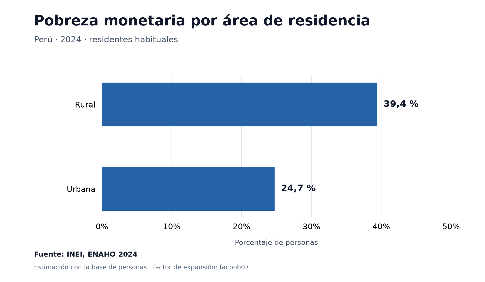
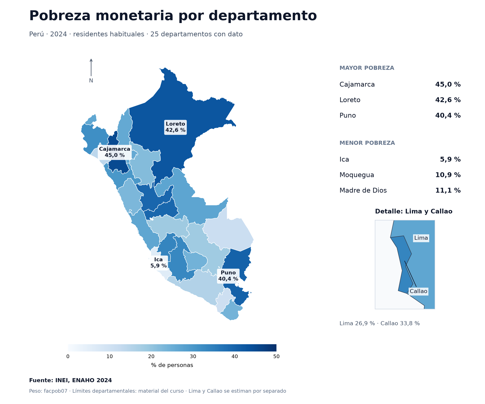

# ENAHO 2024: skills para Codex

Análisis reproducible de pobreza monetaria con los microdatos públicos del INEI y tres skills para Codex/GPT: limpiar, graficar y mapear.
Adaptación del material de la [sesión 16 de Data Science Python](https://github.com/d2cml-ai/Data-Science-Python/tree/main/sessions/16-skills-enaho), originalmente preparado para Claude Code.

## Contenido y resultados

- Paso 1 completado: repositorio, entorno y entradas descargadas y verificadas.
- Paso 2 completado: skill `limpiando-enaho`, base de personas y validación.
- Paso 3 completado: skills `graficando-enaho` y `mapeando-enaho`, tres gráficos y un mapa departamental.
- Paso 4 completado en local: tres pedidos con skills y tres sin sus manifiestos comprobados en los registros de los chats. Una prueba adicional con Codex CLI, sin base limpia al inicio, confirmó limpieza, validación y mapa en ese orden. Registro y límites en [evaluacion.md](evaluacion.md).
- Control en la carpeta vecina `enaho_sin_skills`, con datos, código, documentación y resultados conservados: Cusco respondió 18,5 % por consulta web; gráfico y mapa ejecutaron directamente los programas disponibles y obtuvieron las mismas tasas e imágenes. Protocolo y límites en [docs/control_sin_skills.md](docs/control_sin_skills.md).

Comprobado el 31 de octubre de 2026: `uv lock --check --offline`, carga de las cuatro bibliotecas y lectura del GeoJSON con 25 departamentos en EPSG:4326.
El conjunto pasó 22 pruebas de integridad, ponderación, uniones y manejo de errores; dos ejecuciones completas de limpieza produjeron una base idéntica por SHA-256.
El formato de las tres skills se comprobó con el validador de `skill-creator`. Los scripts e imágenes se comprobaron y se documentaron las seis ejecuciones de la comparación descriptiva del paso 4.

La adaptación y los criterios de cada paso están en [docs/adaptacion_codex.md](docs/adaptacion_codex.md).
El recorrido para presentar los resultados está en [docs/demostracion.md](docs/demostracion.md).
La prueba sin base previa se hizo en una copia independiente, `enaho_sin_base`, con los tres manifiestos y los datos fuente. Su [registro de comprobación](referencias/encadenamiento_sin_base_2024.json) conserva el estado inicial, la evidencia de ejecución y la revisión de los resultados; la base del proyecto principal permaneció intacta.

```text
.agents/skills/    Las tres skills, sus instrucciones, referencias y scripts
scripts/           Descarga, funciones comunes y preparación de evaluaciones
tests/             Pruebas de limpieza, ponderación y uniones
salidas/           Informes de validación; la base Parquet se regenera localmente
figuras/           Gráficos por área, sexo y edad, con CSV y metadatos
mapas/             Mapa departamental, tasas y comprobación de la unión
referencias/       Fuentes, referencias de contraste y registros de evaluación
docs/              Adaptación a Codex, protocolo del control y demostración
evaluacion.md      Tres pedidos con y sin manifiestos y prueba sin base previa
pyproject.toml     Dependencias del proyecto; versiones fijadas en uv.lock
```

## Preparar el entorno

Se usa Python 3.13 y `uv`. Las dependencias exactas están registradas en `uv.lock`.
Con `uv` instalado, desde la raíz del repositorio:

```powershell
git clone https://github.com/bocchienjoyer/enaho_skills.git
cd enaho_skills
uv sync --frozen
uv run --frozen python scripts/preparar_datos.py
```

Como alternativa, se puede instalar `uv` dentro del proyecto en Windows:

```powershell
python -m pip install --target .tools uv==0.13.6
.\.tools\bin\uv.exe sync --frozen --cache-dir .uv-cache
.\.tools\bin\uv.exe run --frozen --cache-dir .uv-cache python scripts/preparar_datos.py
```

No hace falta activar el entorno para usar esos comandos.

## Entradas

| Archivo | Fuente | Contenido |
|---|---|---|
| `datos/966-Modulo34.zip` | [INEI: módulo 34](https://proyectos.inei.gob.pe/iinei/srienaho/descarga/STATA/966-Modulo34.zip) | Sumaria de hogares y diccionarios |
| `datos/966-Modulo02.zip` | [INEI: módulo 02](https://proyectos.inei.gob.pe/iinei/srienaho/descarga/STATA/966-Modulo02.zip) | Miembros del hogar y diccionarios |
| `datos/peru_departamental_simple.geojson` | [Repositorio del curso](https://raw.githubusercontent.com/d2cml-ai/Data-Science-Python/main/sessions/06-geoespacial/lab/Data/peru_departamental_simple.geojson) | Límites de 25 departamentos, con `FIRST_IDDP` |
| `referencias/pobreza_departamento_2024.csv` | [Referencia de la sesión](https://github.com/d2cml-ai/Data-Science-Python/blob/main/sessions/16-skills-enaho/referencias/pobreza_departamento_2024.csv) | Tasas calculadas por el curso con la sumaria, para contrastar |

El script comprueba la integridad de los ZIP, los nombres de los archivos Stata y los 25 códigos del GeoJSON y del CSV.
Guarda las direcciones, tamaños y huellas SHA-256 en `referencias/fuentes_2024.json`.
Si una entrada ya existe, la verifica y la conserva.
Estas comprobaciones todavía no validan el número de personas ni las tasas de pobreza.

Los archivos de `datos/`, la base de personas y el entorno local están excluidos de Git.

## Las tres skills

| Skill | Estado | Entrada | Salida |
|---|---|---|---|
| `limpiando-enaho` | Creada y validada | Módulos 34 y 02 | `salidas/personas_2024.parquet`, `salidas/validacion.txt` y `salidas/validacion_2024.json` |
| `graficando-enaho` | Creada y validada | Base de personas y pregunta | `figuras/pobreza_{area,sexo,edad}_2024.png`, con CSV y JSON |
| `mapeando-enaho` | Creada y validada | Base de personas y GeoJSON | `mapas/pobreza_departamento.png`, con CSV y JSON |

Se ubican en `.agents/skills/`, con un `SKILL.md` y los scripts correspondientes.
Desde Codex abierto en este repositorio, pedir `$limpiando-enaho 2024` para usar la skill de limpieza.
También se pueden pedir `$graficando-enaho 2024 por área` o `$mapeando-enaho 2024`.
Las skills de gráficos y mapas indican usar primero `limpiando-enaho` si falta la base.
Sus scripts rechazan bases con estado ERROR o cuya huella no coincide con el informe de limpieza.

## Ejecutar la limpieza

```powershell
uv run --frozen python .agents/skills/limpiando-enaho/scripts/limpiar.py --anio 2024
```

Con la instalación local de Windows:

```powershell
.\.tools\bin\uv.exe run --frozen --cache-dir .uv-cache python .agents/skills/limpiando-enaho/scripts/limpiar.py --anio 2024
```

El script solo admite 2024. Comprueba el año, las llaves, la residencia, la unión, los pesos y la pobreza antes de guardar la base.
Si falla, termina con un código distinto de cero y deja el informe en ERROR; una base anterior no se considera validada por esa ejecución.
El JSON registra las fuentes y el SHA-256 de la base que sí pasó los controles.

Resultados calculados con las entradas descargadas:

| Control o estimación | Resultado |
|---|---:|
| Hogares de sumaria | 33 691 |
| Registros de miembros | 117 721 |
| Residentes y filas de la base | 108 664 |
| Personas sin hogar correspondiente / filas perdidas o duplicadas | 0 / 0 |
| Departamentos con dato | 25 |
| Pobreza con sumaria y `factor07 × mieperho` | 27,57947 % |
| Pobreza con personas y `facpob07` | 27,52873 % |
| Extrema con sumaria / personas | 5,50453 % / 5,49978 % |

Ambas estimaciones nacionales están a menos de 0,1 puntos porcentuales de las referencias de la guía (27,6 % y 5,5 %).
Las referencias del curso por área y departamento proceden de sumaria: no deben exigirse como redondeos idénticos a las estimaciones de personas.
Las cifras sobre personas se ponderan exclusivamente con `facpob07`.

## Generar gráficos y mapa

Desde la raíz del proyecto, después de la limpieza:

```powershell
uv run --frozen python .agents/skills/graficando-enaho/scripts/graficar.py --anio 2024 --por area
uv run --frozen python .agents/skills/graficando-enaho/scripts/graficar.py --anio 2024 --por sexo
uv run --frozen python .agents/skills/graficando-enaho/scripts/graficar.py --anio 2024 --por edad
uv run --frozen python .agents/skills/mapeando-enaho/scripts/mapear.py --anio 2024
```

Con la instalación local de Windows, sustituir `uv run --frozen python` por `.\.tools\bin\uv.exe run --frozen --cache-dir .uv-cache python`.
Los cuatro PNG se guardan a 200 dpi. Cada uno tiene una tabla CSV con las tasas y un JSON que registra el peso y la huella de la base usada.
La comprobación y la agregación compartidas están en `scripts/enaho_comun.py`.

Los gráficos muestran barras de un solo color, ordenadas por tasa y con eje desde cero.
Para edad se usan grupos 0–17, 18–29, 30–44, 45–59 y 60 años o más.
El mapa une por `departamento` y `FIRST_IDDP` como códigos de dos caracteres; exige 25 códigos únicos a ambos lados, geometrías válidas y correspondencia completa.
Usa azul de claro a oscuro desde cero e incluye un detalle de Lima y Callao, estimados por separado.

| Resultado de personas | Tasa |
|---|---:|
| Pobreza rural / urbana | 39,44168 % / 24,73524 % |
| Mujeres / hombres | 27,67573 % / 27,37065 % |
| Cajamarca / Loreto / Puno | 44,99496 % / 42,60510 % / 40,41768 % |
| Ica / Moquegua / Madre de Dios | 5,91394 % / 10,87809 % / 11,13591 % |
| Lima / Callao | 26,88877 % / 33,76834 % |

`mapas/pobreza_departamento.csv` incluye la referencia redondeada de sumaria y su diferencia en puntos porcentuales respecto de personas.
La mayor diferencia es 0,51768 puntos en Puno; la unión se comprobó por código y las 25 tasas se contrastaron directamente con la base de personas.
La tolerancia nacional de 0,1 puntos no se aplica a estas comparaciones departamentales entre universos distintos.





## Comprobar el proyecto

Para ejecutar las pruebas:

```powershell
uv run --frozen python -m unittest discover -s tests -v
```

## Fuentes de la adaptación

- [Presentación de la clase](https://claude.ai/artifact/X7H6PUvaWKde1epsYCJNze).
- [Consigna y rúbrica](https://github.com/d2cml-ai/Data-Science-Python/blob/main/sessions/16-skills-enaho/README.md).
- [Documentación oficial de skills en Codex](https://learn.chatgpt.com/docs/build-skills).
